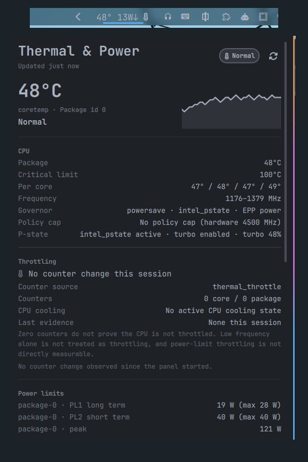

# Thermal & Power



A read-only CPU temperature, throttling-evidence, battery-power and power-profile widget for the
[Omarchy](https://omarchy.org/) bar.

The bar shows a compact label such as `47° 24W↓`. Click it for a detail panel with a five-minute
in-memory sparkline, per-core and other sensors, throttling evidence, power limits, battery facts,
a profile switcher and explicit “not exposed” messages when Linux does not publish a value.

- Plugin id: `io.github.manish0467.thermal-power`
- Repository: <https://github.com/manish0467/omarchy-thermal-power>
- License: MIT
- Author: Manish
- Tested on Omarchy `4.5.0-3`

> **Tested version note:** `omarchy-version` reports `4.5.0-3` on the test machine, while
> `/usr/share/omarchy/version` may still contain the stale value `4.0.0.alpha`. Trust
> `omarchy-version` when checking compatibility.

## What it shows

The default bar fields are CPU temperature and battery power:

```text
47° 24W↓
```

- Temperature is the CPU package sensor when one is available. Otherwise a named thermal zone is
  used, and the panel says which source was selected.
- Power comes from the battery. A down arrow means discharging; an up arrow means charging input.
  `AC` is shown when the battery is idle on mains power.
- The profile glyph is optional and is **not** shown by default. It can be enabled with the
  `profile` bar field.
- `--` means a value is unavailable, not zero. The panel explains what is missing.

Panel states are `Normal`, `Warm`, `Hot`, `Throttling evidence`, and `Unavailable`. The defaults are
warm at 80 °C and hot at 90 °C. These are **starting points, not universal hardware limits**. CPU
package sensors, hotspot sensors and OEM limits differ between machines; check your own sensors and
firmware documentation before treating any threshold as a safety limit.

## Install

### From the Omarchy plugin marketplace

When the plugin is published, install it from the marketplace or with:

```bash
omarchy plugin add https://github.com/manish0467/omarchy-thermal-power --enable
```

The widget is placed in the right section by default. Configure it through Omarchy's plugin
settings.

### Local development checkout

```bash
git clone https://github.com/manish0467/omarchy-thermal-power.git ~/omarchy-thermal-power
ln -s ~/omarchy-thermal-power ~/.config/omarchy/plugins/io.github.manish0467.thermal-power
omarchy plugin enable io.github.manish0467.thermal-power
```

Validate the checkout **before** creating the symlink:

```bash
cd ~/omarchy-thermal-power
omarchy plugin validate .
```

The Omarchy validator rejects a plugin folder that is itself a symlink or contains symlinks. For
development, validate the real checkout first, then symlink it. To remove a development symlink,
disable the plugin and delete the link with `rm`; do **not** run `omarchy plugin remove` on a symlink.

### Requirements

- Omarchy `4.5.0-3` tested
- A `python3` (3.9 or newer) on `PATH`; the helper uses only the Python standard library
- Quickshell's native UPower service
- `power-profiles-daemon` for the profile switcher; the rest of the widget works without it
- No root, sudo, pkexec, polkit rule, network access, package installation, SMART access or fan
  control is used

## The built-in power widget

Omarchy's built-in `omarchy.power` widget is kept and is never modified by this plugin. Both widgets
can show battery power, so the bar may look redundant.

If you want only this widget's power summary:

```bash
omarchy plugin disable omarchy.power
```

Re-enable it later with:

```bash
omarchy plugin enable omarchy.power
```

This plugin does not disable the built-in widget automatically and does not edit your bar layout
while it runs.

## Configuration

All settings are exposed through Omarchy's plugin settings and the widget manifest.

| Setting | Default | Meaning |
| --- | --- | --- |
| `barFields` | `["temp", "power"]` | Which compact fields to show: temperature, battery power, profile glyph. The panel always shows all details. |
| `warmThreshold` | `80` °C | Amber state threshold. A starting point, not a hardware limit. |
| `hotThreshold` | `90` °C | Red state threshold. A starting point, not a hardware limit. |
| `unit` | `c` | Display Celsius or Fahrenheit. Thresholds remain in Celsius. |
| `pollClosedSeconds` | `10` | Collector interval while the panel is closed. |
| `pollOpenSeconds` | `2` | Collector interval while the panel is open. |
| `historyMinutes` | `5` | In-memory sparkline window. Lost when the shell restarts. |
| `notifyTemp` | `false` | Sustained high-temperature notification. Off by default. |
| `notifyTempC` | `92` °C | Temperature notification threshold. |
| `notifyTempSeconds` | `90` | Required sustain time. |
| `notifyPower` | `false` | Sustained high battery-draw notification. Off by default. Only fires while discharging. |
| `notifyPowerW` | `30` W | Battery draw threshold. |
| `notifyPowerSeconds` | `60` | Required sustain time. |
| `notifyCooldownMinutes` | `15` | Per-notification cooldown. |
| `mockScenario` | empty | Development-only preview fixture. Empty means real sensors. |

Notifications use `omarchy-notification-send` with normal urgency. The charging `ChangeRate` from
UPower is charger input, so it is never used for the discharge notification.

## What this plugin writes

While polling, the plugin **writes nothing**. It does not create a plugin state directory, does not
edit sysfs, and keeps history and notification cooldowns in memory only.

There are two intentional side effects:

1. **Profile preference files, only after an explicit profile click.** Clicking a profile runs
   `omarchy-powerprofiles-set autodetect <profile>`. That Omarchy command writes its per-power-source
   preferences:

   - `~/.local/state/omarchy/powerprofiles/ac`
   - `~/.local/state/omarchy/powerprofiles/battery`

   The plugin does not create, own or directly edit those files; Omarchy's command does. This is
   deliberate: it keeps Omarchy's own menu and this panel in sync and remembers the choice for AC
   and battery power. The plugin never changes the profile on its own.

2. **Bar layout changes made by Omarchy itself.** Installing, enabling, moving or disabling a widget
   changes `~/.config/omarchy/shell.json` through Omarchy's plugin/bar commands. The plugin runtime
   does not edit your layout. If you temporarily enable this widget for development, restore your
   layout afterwards.

## What this plugin runs and reads

Every sample runs the standard-library helper with argv only, never through a shell:

```bash
python3 -I /path/to/omarchy-thermal-power/helper/thermal_power.py
```

The helper reads these read-only sysfs trees:

- `/sys/class/hwmon/*` — `temp*_input`, `temp*_label`, `temp*_crit`, `fan*_input`, `fan*_label`
- `/sys/class/thermal/*` — thermal zones, trip points and cooling-device state
- `/sys/class/powercap/*` — readable `constraint_*_power_limit_uw` limits only
- `/sys/class/power_supply/*` — battery and AC state
- `/sys/devices/system/cpu/*` — `cpufreq` policy data, `thermal_throttle` counters and intel/amd pstate

The panel also uses Quickshell's native UPower service, which reads standard UPower D-Bus properties
from `org.freedesktop.UPower.Device` (`IsPresent`, `State`, `Percentage`, `ChangeRate`,
`TimeToFull`, `TimeToEmpty`) and `OnBattery` from `org.freedesktop.UPower`.

For the profile state and manager check, the panel runs exactly these probes:

```bash
busctl --json=short get-property \
  org.freedesktop.UPower.PowerProfiles \
  /org/freedesktop/UPower/PowerProfiles \
  org.freedesktop.UPower.PowerProfiles \
  ActiveProfile
```

```bash
systemctl is-active tuned.service tlp.service auto-cpufreq.service power-profiles-daemon.service
```

The profile switcher accepts only the fixed allow-list `power-saver`, `balanced`, and
`performance`. Performance is shown only when power-profiles-daemon advertises it. A click runs:

```bash
omarchy-powerprofiles-set autodetect <profile>
```

No value from a sensor, profile name, or file is interpolated into a shell string. There is no
network access, no sudo, no pkexec, no polkit action, no fan control, no SMART access, and no RAPL
energy-counter read. RAPL energy counters are root-only on many laptops; this plugin displays
readable powercap limits instead and explicitly does not use them as consumption measurements.

## Other sensors and unavailable values

The panel has a collapsed **Other sensors** group for NVMe, ACPI and other readable chips. It is
read-only. Fan RPM is shown when a `fan*_input` exists; this laptop exposes none, so the panel says
`No fan RPM sensor exposed` rather than showing `0`.

When the kernel does not expose a value, the panel says so. When no CPU temperature is found, the
bar shows a question glyph and `--` for temperature. Battery power may still come from UPower.

## Mock previews

The `mockScenario` setting loads a fixture instead of sysfs. It is intended for development and
visual review; fixtures never fall back to real sysfs.

| Fixture | Purpose |
| --- | --- |
| `normal` | Normal temperatures, discharging battery |
| `warm` | Warm state |
| `hot` | Hot state |
| `throttling` | Throttling evidence |
| `no-battery` | No battery exposed |
| `no-sensors` | No CPU temperature |
| `profile-daemon-missing` | Profile daemon unavailable |
| `on-ac-charging` | Charging input and charging direction |
| `preview` | Richer seeded history for screenshots |

Mock profile clicks only change the preview state; they never invoke
`omarchy-powerprofiles-set`.

## Tests

```bash
cd ~/omarchy-thermal-power
node tests/test_model.js
python3 -I tests/test_helper.py
python3 -I tests/stress_helper.py --runs 320
```

The stress loop launches the same `python3 -I` command 300+ times and fails on a non-zero exit,
stderr output, invalid JSON or wrong schema. It is a process-startup check, not a hardware stress
test. See [`docs/TEST_PLAN.md`](docs/TEST_PLAN.md) for the full manual and safety checklist.

## Performance

The design target is no measurable battery impact. The helper is a short-lived process; there is no
background daemon. On the test machine
(Python 3.14.8, 320 runs) it averaged about 110 ms per invocation in a parallel run; an isolated
benchmark was around 99–110 ms. That is roughly 1% of one CPU core while polling every 10 s with the
panel closed, and roughly 5–6% of one core while the panel is open every 2 s. On an 8-thread CPU the
open-panel share is under 1% of total CPU capacity. History and cooldowns are memory-only. These
figures are measurements from one machine, not a guarantee.

## Limitations

- “Throttling evidence” is deliberately conservative. A counter increase or an active CPU cooling
  device is evidence. Zero counters do **not** prove the CPU is not throttled; low frequency alone
  is not treated as throttling; power-limit throttling is not directly measurable without root.
- Battery power may be unavailable in sysfs. UPower's `ChangeRate` is used as a fallback and is
  labelled as UPower data. While charging it represents charger input, not CPU consumption.
- The built-in `omarchy.power` widget remains available and may duplicate the battery summary.
- Thresholds are display hints. The plugin does not change fan curves, power limits, governor
  settings or firmware behaviour.

## License

MIT. See [`LICENSE`](LICENSE).

Maintainer and marketplace notes are in [`docs/MAINTAINER.md`](docs/MAINTAINER.md).
